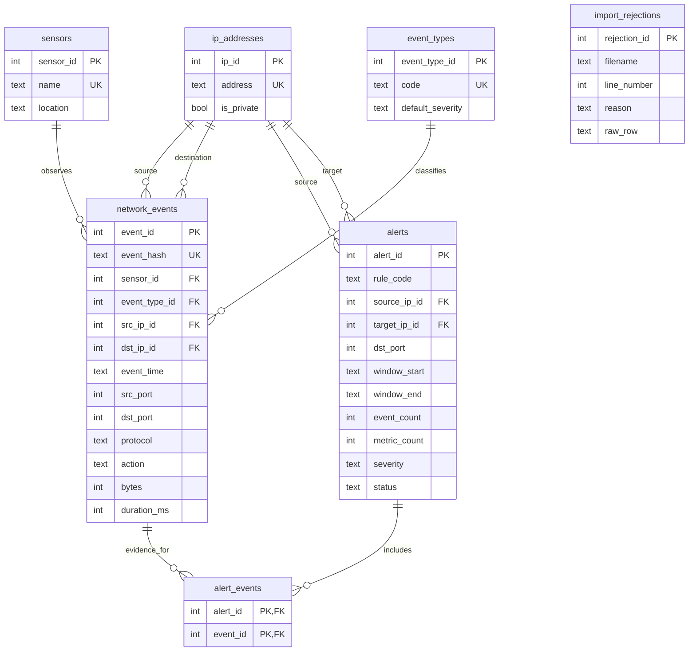

# Entity relationship diagram

The seven tables include six related domain tables plus a standalone import audit table. The `alert_events` junction records exactly which event IDs support each alert. `alerts` uniqueness is `(rule_code, source_ip_id, target_ip_id, COALESCE(dst_port,-1), window_start, window_end)`.
