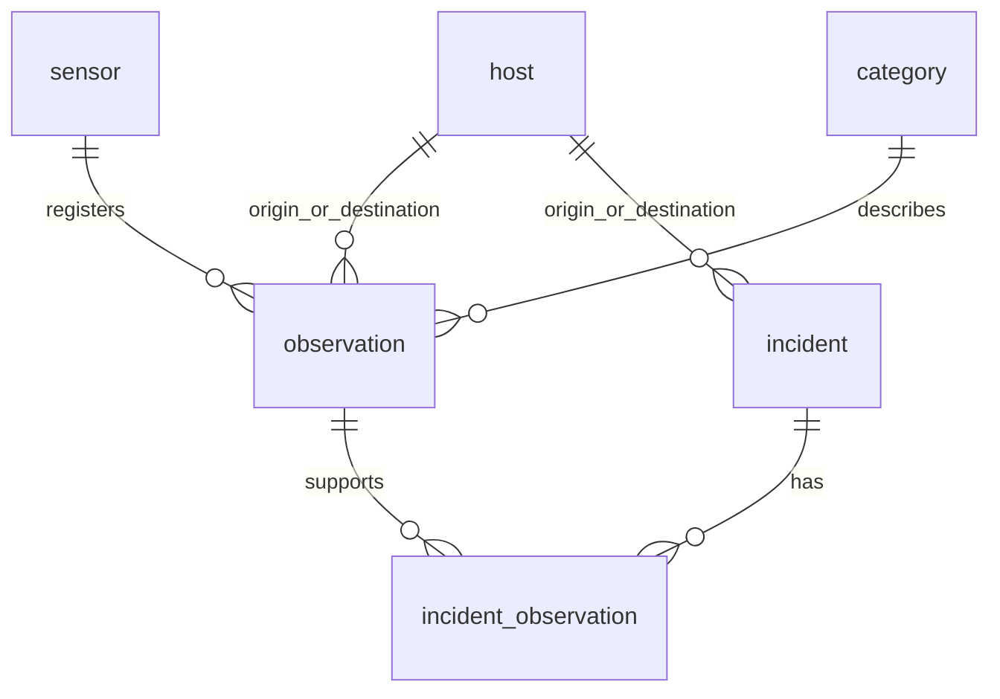

# Sentinel — wersja 2

Druga implementacja zadania Network Security Event Analyzer. Python 3.10+, SQLite 3.24+, wyłącznie biblioteka standardowa. Brak instalowania pakietów. Rozpakuj ZIP i uruchamiaj polecenia z folderu analyzer_v2.

## Szybki start

Gotowa baza `security.sqlite3` zawiera 896 zaimportowanych zdarzeń, trzy alerty oraz dowody.

```bash
python -m sentinel show alerts
python -m sentinel show types
python -m sentinel proof 1
python -m unittest discover -s tests -v
```

Odtworzenie na świeżej bazie (wybierz nazwę nieistniejącego pliku):

```bash
python -m sentinel --database nowa.sqlite3 demo
```

Albo poszczególne etapy:

```bash
python -m sentinel --database nowa.sqlite3 setup
python -m sentinel --database nowa.sqlite3 load data/events.csv
python -m sentinel --database nowa.sqlite3 analyze
python -m sentinel --database nowa.sqlite3 show alerts --format csv --save output/nowe_alerty.csv
```

Uruchomienie powtórnego load pomija duplikaty. Powtórne analyze dla tego samego zbioru i konfiguracji aktualizuje te same alerty, zachowując stan i datę utworzenia. Wynik analyze to liczba dopasowanych okien, a nie liczba nowych wpisów.

## Inne podejście do rozwiązania

| Element | Implementacja tej wersji |
|---|---|
| Organizacja | Pakiet sentinel uruchamiany python -m sentinel |
| Reprezentacja | Niezmienny obiekt Event (frozen dataclass) i klasa Store |
| Czas w bazie | INTEGER: mikrosekundy od epoki UTC, bez operacji zmiennoprzecinkowych |
| Detekcja | SQL z self JOIN i CTE dla przesuwanych okien zakotwiczonych w czasie zdarzenia |
| Wybór alertów | Najsilniejsze niepokrywające się okna dla pary endpointów i usługi |
| Konfiguracja | Walidowany settings.json |
| CLI | setup, load, analyze, show, status, proof, demo |

model.py odpowiada za parser, model danych, czas i odcisk SHA-256. storage.py zawiera repozytorium i kontrolę życia połączenia. ingest.py realizuje strumieniowy import CSV w transakcji. engine.py tworzy kandydatów SQL i wybiera okna w Pythonie. analytics.py zawiera osiem rzeczywistych raportów SQL i formatowanie. __main__.py obsługuje CLI.

## Relacje i ograniczenia



Sześć tabel z PK, FK, UNIQUE, NOT NULL i CHECK. observation normalizuje sensory, typy oraz adresy. incident ma osobny klucz signature z SHA-256 reguły, endpointów, usługi i granic okna. incident_observation udostępnia pełne dowody. Indeksy wspierają filtrowanie endpointów i czasu. Oba adresy źródłowy/docelowy wskazują host. Port NULL oznacza brak portu albo wszystkie usługi w alercie PORT_SCAN. Prywatność adresu pochodzi z ipaddress.is_private; nie stanowi oceny reputacji i nie jest ograniczona do RFC1918.

## Kontrakt CSV

Plik data/events.csv to kopia dostarczonego zbioru bez zmian.

```csv
timestamp,sensor_name,src_ip,dst_ip,src_port,dst_port,protocol,event_type,action,bytes,duration_ms
```

Nagłówek zawiera dokładnie te kolumny, w dowolnej kolejności. Dodatkowe, brakujące i powtórzone nazwy są odrzucane. Timestamp wymaga ISO 8601 z T. Czas bez strefy oznacza UTC, czas z przesunięciem jest przeliczany do UTC. Obsługujemy daty od 1970, dokładność mikrosekundową. Formatowanie UTC na raportach jest jawne. IPv4/IPv6 przechodzą ipaddress i są zapisywane w postaci kanonicznej. Nazwa sensora musi być niepusta; nowa poprawna nazwa tworzy sensor. Znane typy: CONNECTION, HTTP_REQUEST, DNS_QUERY, AUTH_SUCCESS, AUTH_FAILURE. Protokół: TCP/UDP/ICMP. Akcja: ALLOW/BLOCK. Porty: 1–65535 lub puste. bytes/duration_ms: nieujemne liczby całkowite mieszczące się w SQLite INTEGER.

Nie wymuszamy zgodności protokołu z typem zdarzenia, bo dane syntetyczne zawierają nietypowe kombinacje. Nie poprawiamy niepoprawnych wartości. Normalizacja IP i strefy jest udokumentowana, a oryginał CSV zostaje zachowany. Niepoprawny wiersz trafia do errors z numerem linii i powodem; import kontynuuje. Błąd zapisu bazy wycofuje całą partię. Hash wszystkich pól Event zapewnia idempotencję importu. Identyczne rekordy bez unikalnego ID źródłowego uznajemy za duplikaty.

Wynik pierwszego importu: read=896, imported=896, rejected=0, duplicates=0. Powtórny import: imported=0, duplicates=896.

## Reguły przesuwanych okien

| Reguła | Grupowanie | Próg | Okno | Severity |
|---|---|---|---|---|
| PORT_SCAN | źródło + cel | >=20 różnych portów docelowych | 300 s | HIGH |
| BRUTE_FORCE | źródło + cel + port | >=8 AUTH_FAILURE | 300 s | HIGH |
| TRAFFIC_FLOOD | źródło + cel + port | >=150 zdarzeń | 60 s | CRITICAL |

Konfiguracja w settings.json. Własną konfigurację uruchomisz przez `python -m sentinel analyze --config inny.json`.

Każde przesuwane okno zaczyna się w czasie zdarzenia i ma zakres [początek,początek+długość). SQL generuje unikalne kotwice, dzięki czemu wiele zdarzeń w tej samej mikrosekundzie nie mnoży liczników. Self JOIN wylicza liczbę zdarzeń oraz liczbę różnych portów. BRUTE_FORCE filtruje dowody do AUTH_FAILURE. PORT_SCAN liczy różne porty inne niż NULL, ale quantity obejmuje wszystkie zdarzenia okna. Pozostałe reguły grupują brak portu jako osobną usługę NULL. Agregujemy sensory, akcje i protokoły razem.

Kandydaci są sortowani po malejącym wyniku, liczbie zdarzeń, następnie rosnącym czasie i endpointach. Dla każdego klucza źródło/cel/usługa wybieramy najsilniejsze okno i pomijamy nakładające się okna tej samej reguły. Kolejne rozłączne okna mogą utworzyć osobne alerty. Próg zostaje oceniony w SQL; Python ogranicza powtarzające się ostrzeżenia. Dowody przechowują wszystkie pasujące ID zdarzeń. Każdy opis podaje regułę, endpointy, usługę, czas, licznik i próg.

## Rzeczywiste wyniki

Wszystkie daty: 2026-09-18, UTC.

| Reguła | Źródło | Cel | Okno | Zdarzenia | Wynik |
|---|---|---|---|---|---|
| PORT_SCAN | 198.51.100.66 | 10.0.0.20 | 10:12–10:17 | 26 | 26 różnych portów |
| BRUTE_FORCE | 203.0.113.23 | 10.0.0.15:22 | 10:22–10:27 | 10 | 10 błędów logowania |
| TRAFFIC_FLOOD | 198.51.100.77 | 10.0.0.20:443 | 10:40–10:41 | 160 | 160 zdarzeń |

To wzorce do sprawdzenia przez człowieka: należy porównać aktywność z planem skanów, logami uwierzytelniania i normalnym ruchem usługi. Alert sam nie dowodzi ataku.

## Raporty i statusy

```bash
python -m sentinel show types
python -m sentinel show sources
python -m sentinel show services
python -m sentinel show states
python -m sentinel show timeline
python -m sentinel show targets
python -m sentinel show unusual-sources
python -m sentinel show alerts --format json
python -m sentinel status 1 INVESTIGATING
python -m sentinel proof 1
```

Raporty SQL obejmują typy zdarzeń, top 10 źródeł, usługi docelowe, severity/status, oś minutową, top cele i źródła o liczniku powyżej średniej. Stosują JOIN, GROUP BY, agregacje, HAVING i podzapytanie. Status: NEW, INVESTIGATING, CLOSED. Formaty: czytelny tekst, CSV i JSON. `--save output/nazwa.csv` zapisuje wynik. demo pokazuje import, analizę i wszystkie raporty.

## Testowanie i bezpieczeństwo danych

```bash
python -m unittest discover -s tests -v
```

15 testów: walidacja, nagłówki, duplikaty, przepełnienia, FK, rollback całego importu, wszystkie reguły i progi, rozdzielenie usług, UTC/IPv6/NULL, granica wyłączna, wykrywanie ponad granicą stałego kubełka, niepomnażanie kotwic, raporty, błędna konfiguracja oraz dane źródłowe i ponowna detekcja. Szczegóły w output/tests.txt. Wszystkie testy przechodzą.

Wartości użytkownika wiążemy przez parametry SQL. Dynamiczne fragmenty zapytań wybiera kod z zamkniętego zestawu. Zapis importu i detekcji działa transakcyjnie, połączenia są zamykane przez Store, a foreign_keys jest włączone przy każdym połączeniu.

## Ograniczenia i założenia

Progi pochodzą z zadania. Monitoring i skanery mogą wywoływać fałszywe alarmy. Rozproszone lub powolne działanie może pozostać niewykryte. Brak payloadów, reputacji IP i tożsamości użytkowników. NAT i proxy utrudniają przypisywanie aktywności. Zbiór syntetyczny nie oddaje całej sieci. Nie przechwytujemy ruchu i nie blokujemy hostów.

Przesuwane okna ograniczają problem granic stałych kubełków, ale wybór najsilniejszych okien ukrywa część nakładających się wykryć. Self JOIN jest dobry dla tego małego zbioru, a dla milionów rekordów wymaga optymalizacji i przetwarzania partiami. Po doimportowaniu danych lub zmianie ustawień silniejsze okno może zastąpić poprzednie w bieżących wynikach analizy. Historyczne alerty pozostają w bazie do audytu, więc czyste porównanie konfiguracji należy wykonać na nowej bazie. Nie ma automatycznego usuwania alertów ani reakcji sieciowej.
