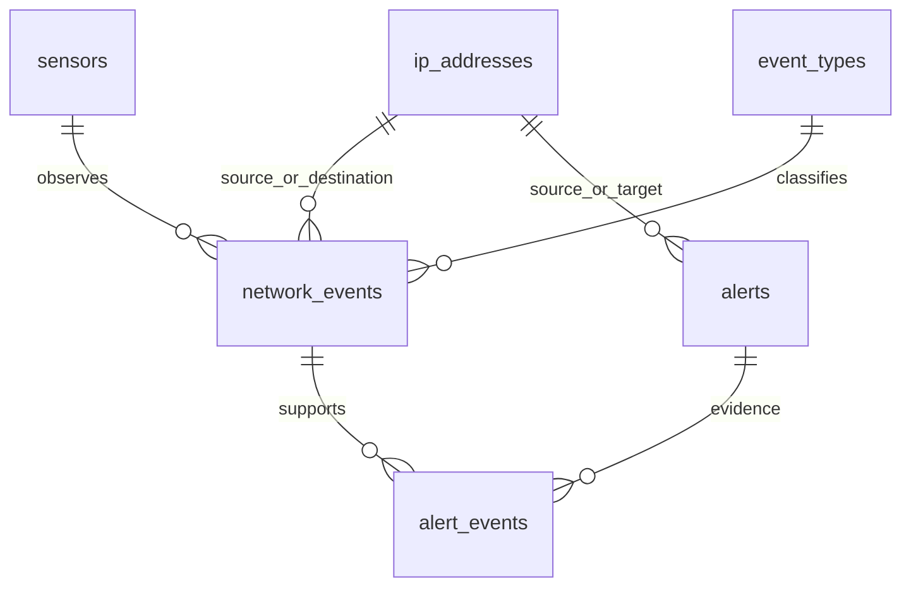

# Network Security Event Analyzer

Kompletne zadanie Python + SQLite. Wymagany Python 3.10+ z SQLite 3.35+ (RETURNING). Wyłącznie biblioteka standardowa, bez pip install. Rozpakuj ZIP i otwórz terminal w folderze network_analyzer.

## Uruchomienie

Gotowa baza `network_events.db` zawiera 896 zdarzeń i 3 alerty z powiązanymi dowodami.

```bash
python main.py summary
python main.py report
python main.py evidence 1
python -m unittest -v
```

Odtworzenie na świeżej bazie (nazwa demo.db powinna jeszcze nie istnieć):

```bash
python main.py --db demo.db init-db
python main.py --db demo.db import-csv data/network_events_sample.csv
python main.py --db demo.db summary
python main.py --db demo.db detect
python main.py --db demo.db report
python main.py --db demo.db report --format csv --output reports/demo_alerts.csv
python main.py --db demo.db detect
python main.py --db demo.db set-status 1 INVESTIGATING
python main.py --db demo.db evidence 1
```

Powtórny import: 896 duplikatów, 0 nowych rekordów. Powtórne detect: 3 dopasowania, nadal 3 rekordy alertów. Wynik detect liczy dopasowane okna, a nie wyłącznie nowo utworzone alerty. Aktualizacja detekcji zachowuje status i created_at.

## Pliki

- schema.sql: tabela i indeksy, PK/FK/NOT NULL/UNIQUE/CHECK.
- db.py: połączenie, foreign_keys, inicjalizacja, zamykanie zasobów.
- importer.py: CSV, walidacja, SHA-256 do deduplikacji, transakcja.
- config.py: znane typy i progi.
- detection.py: SQL grupujący, zapisywanie alertów oraz dowodów.
- reports.py: osiem zapytań analitycznych, eksport tekst/CSV/JSON.
- cli.py i main.py: interfejs terminala.
- test_analyzer.py: 13 testów na bazach w pamięci i plikach tymczasowych.
- data/: oryginalny CSV, reports/: rzeczywiste wyniki i testy.

## Model relacyjny



Sześć tabel. sensors przechowuje unikatową nazwę i opcjonalną lokalizację. Nowa nazwa sensora tworzy rekord wymiaru. event_types jest kontrolowanym słownikiem. ip_addresses zapisuje kanoniczny adres oraz wynik ipaddress.is_private (nie oznacza to wyłącznie RFC1918 i nie jest oceną reputacji). network_events odwołuje się do sensorów, typów i adresów przez FK. alerts ma klucz unikatowy reguła/źródło/cel/usługa/okno. alert_events wiąże alert z konkretnymi event_id. service_port=0 oznacza wszystkie porty dla skanu albo brak portu dla pozostałych reguł. W zdarzeniach brak portu zapisuje SQL NULL.

## CSV i walidacja

Dokładny nagłówek (kolejność kolumn może się różnić):

```csv
timestamp,sensor_name,src_ip,dst_ip,src_port,dst_port,protocol,event_type,action,bytes,duration_ms
```

Timestamp ISO 8601 z T; brak strefy oznacza UTC, jawne przesunięcie przeliczane jest na UTC. Baza przechowuje format YYYY-MM-DDTHH:MM:SS.ffffffZ. Adres IPv4/IPv6 jest walidowany i normalizowany. sensor_name nie może być pusty. Port to liczba 1–65535 albo puste pole. bytes/duration_ms są nieujemnymi liczbami całkowitymi. Protocol: TCP/UDP/ICMP. Action: ALLOW/BLOCK. Typy: CONNECTION, HTTP_REQUEST, DNS_QUERY, AUTH_SUCCESS, AUTH_FAILURE. Nie wymuszamy zgodności typu z protokołem, bo syntetyczne dane zawierają nietypowe kombinacje.

Oryginalny CSV pozostaje w data/. Normalizacja czasu i adresów jest jawna. Nie poprawiamy błędnych pól ani nie zgadujemy wartości. Wiersze niepoprawne mają numer linii i powód w wyniku importu. Błędny nagłówek przerywa import. Błąd bazy wycofuje całą partię; błędy walidacji pomijają tylko dany wiersz. Hash wszystkich znormalizowanych pól zapewnia idempotencję; identyczne zdarzenia bez identyfikatora źródłowego traktujemy jako duplikaty.

## Reguły i okna

| Reguła | Grupowanie | Próg | Severity |
|---|---|---|---|
| PORT_SCAN | źródło + cel, 5 minut | co najmniej 20 różnych dst_port | HIGH |
| BRUTE_FORCE | źródło + cel + dst_port, 5 minut | co najmniej 8 AUTH_FAILURE | HIGH |
| TRAFFIC_FLOOD | źródło + cel + dst_port, 1 minuta | co najmniej 150 zdarzeń | CRITICAL |

Stałe w config.py. Okna są stałymi kubełkami wyrównanymi do epoki UTC: [start,end). 5 minut oznacza np. 10:10–10:15; minuta 10:40–10:41. Ruch po obu stronach granicy nie jest łączony. Reguły agregują wszystkie sensory, protokoły i akcje. BRUTE_FORCE uwzględnia tylko AUTH_FAILURE. PORT_SCAN pomija NULL przy liczeniu różnych portów, ale event_count opisuje wszystkie zdarzenia grupy. metric_value opisuje liczbę różnych portów albo liczbę zdarzeń. Opis alertu zawiera regułę, endpointy, okno, licznik i próg. SQL grupuje, Python steruje zapisem w jednej transakcji.

## Wyniki dla dostarczonych danych

Import: read=896, imported=896, rejected=0, duplicates=0.

| Reguła | Źródło | Cel | Okno UTC | Wynik |
|---|---|---|---|---|
| PORT_SCAN | 198.51.100.66 | 10.0.0.20 | 10:10–10:15 | 23 zdarzenia / 23 porty |
| BRUTE_FORCE | 203.0.113.23 | 10.0.0.15:22 | 10:20–10:25 | 10 nieudanych logowań |
| TRAFFIC_FLOOD | 198.51.100.77 | 10.0.0.20:443 | 10:40–10:41 | 160 zdarzeń |

Wszystkie okna dotyczą 2026-09-18. To obserwacje wymagające analizy. Zalecenie: zweryfikować właścicieli źródeł, planowane skanery, logi logowania i kontekst usługi.

## Raporty SQL

```bash
python main.py report --name event-types
python main.py report --name top-sources
python main.py report --name services
python main.py report --name alerts-overview
python main.py report --name timeline
python main.py report --name top-targets
python main.py report --name above-average-sources
python main.py report --name alerts --format json
```

summary pokazuje siedem raportów naraz. Zapytania stosują JOIN, agregacje, grupowanie czasu i podzapytanie (źródła powyżej średniej). Pełne zestawienia są w reports/summary.txt. Stan alertu zmienia set-status: NEW, INVESTIGATING, CLOSED. Polecenie evidence pokazuje rekordy, które uzasadniają dany alert.

## Testy i ograniczenia

Testy: poprawny CSV, duplikaty, błędne pola i nagłówek, FK, wszystkie trzy progi i wartości poniżej progów, granice okien, rozdzielenie usług, IPv6/strefy/NULL, raporty, zachowanie statusu, powtarzalność i oryginalny zbiór. Wynik: 13/13 OK.

Progi są heurystyczne, dobrane zgodnie ze specyfikacją. Skanery, proxy i monitoring mogą powodować fałszywe alarmy. Powolne lub rozproszone działania oraz granice stałych okien mogą ukryć wzorzec. Dane syntetyczne nie zawierają payloadów ani tożsamości użytkowników, NAT i współdzielone IP utrudniają przypisanie aktywności. Reputacja adresu nie jest oceniana. Nie ma przechwytywania pakietów, atakowania sieci ani automatycznego blokowania. Alert wymaga oceny człowieka.

Wartości wejściowe SQL są wiązane parametrami. Dynamiczne fragmenty SQL pochodzą wyłącznie ze stałych wewnętrznych reguł i nazw raportów, nigdy z dowolnego tekstu użytkownika. Połączenia są zamykane, FK włączone dla każdego połączenia. Brak zewnętrznych zależności.
