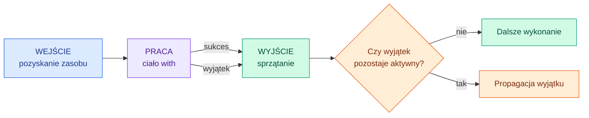
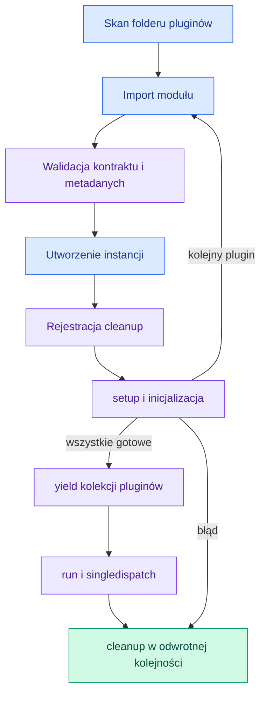
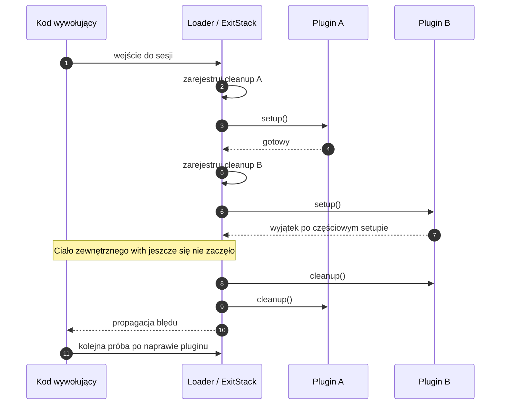

<a name="top"></a>

<div align="center">

<sub>PYTHON · ZARZĄDZANIE ZASOBAMI · ĆWICZENIA 1–4</sub>

# 🧩 Context Managers

### Od prostego `with` do bezpiecznego systemu pluginów

**Hubert Zarychta** · ZZSP · 2026/2027

<p>
  
  
  
</p>

<p>
  <a href="#fundamenty">Podstawy</a> ·
  <a href="#cwiczenie-1">Timery</a> ·
  <a href="#cwiczenie-2">Zasoby</a> ·
  <a href="#cwiczenie-3">ExitStack</a> ·
  <a href="#plugin-loader">Plugin loader</a> ·
  <a href="#sciaga">Ściąga</a>
</p>

</div>

---

> [!IMPORTANT]
> **Context manager wyznacza czas życia zasobu lub tymczasowej zmiany stanu.**
> Wejście przygotowuje warunki do pracy, blok `with` wykonuje zadanie, a wyjście
> uruchamia sprzątanie — również wtedy, gdy podczas pracy pojawi się wyjątek.

<table>
<tr>
<td width="33%" valign="top">
<strong>01 · PRZEWIDYWALNOŚĆ</strong><br />
Zasób ma wyraźny początek i koniec użycia. Zamknięcie pliku nie zależy od chwili uruchomienia garbage collectora.
</td>
<td width="33%" valign="top">
<strong>02 · ODPORNOŚĆ NA BŁĘDY</strong><br />
Ścieżka sprzątania działa po sukcesie oraz po wyjątku. Nie trzeba powielać jej przy każdym miejscu wyjścia.
</td>
<td width="33%" valign="top">
<strong>03 · KOMPOZYCJA</strong><br />
Wiele zasobów można połączyć w jedną sesję, a następnie zwolnić je w odwrotnej kolejności.
</td>
</tr>
</table>

<details>
<summary><strong>🧭 Mapa dokumentu — wybierz poziom szczegółowości</strong></summary>

| Rozdział | Pytanie, na które odpowiada |
| :--- | :--- |
| [01 · Fundamenty](#fundamenty) | Co właściwie daje `with`? |
| [02 · Protokół](#protokol) | Jak współpracują `__enter__()` i `__exit__()`? |
| [03 · Generatory](#generatory) | Jak działa `@contextmanager` i dlaczego potrzebne jest `finally`? |
| [04 · Ćwiczenie 1](#cwiczenie-1) | Czym różnią się dwa timery z mojego kodu? |
| [05 · Ćwiczenie 2](#cwiczenie-2) | Jak obsługiwać transakcje i przywracać stan procesu? |
| [06 · Ćwiczenie 3](#cwiczenie-3) | Kiedy użyć `ExitStack`, `suppress` i `closing`? |
| [07 · Ćwiczenie 4](#plugin-loader) | Jak wykorzystać te mechanizmy w loaderze pluginów? |
| [08 · Awaria i odzyskiwanie](#awaria) | Co dzieje się, gdy drugi plugin nie zdoła się załadować? |
| [09 · Poziom zaawansowany](#advanced) | Gdzie kończą się gwarancje i kto odpowiada za zasób? |
| [10 · Weryfikacja](#weryfikacja) | Co powinno sprawdzać 10 testów? |
| [11 · Ściąga](#sciaga) | Jaki mechanizm wybrać i jak uniknąć typowych błędów? |
| [12 · Źródła](#zrodla) | Gdzie znajdują się ćwiczenia i dokumentacja? |

</details>

<a name="fundamenty"></a>

## 01 · Fundamenty: zasób ma swój czas życia

Zasobem może być plik, połączenie z bazą, blokada lub obiekt pluginu. Context
manager może też zarządzać **tymczasowym stanem**, na przykład zmienionym
katalogiem roboczym albo wartością zmiennej środowiskowej.

```python
with open("example.txt", "w", encoding="utf-8") as file:
    file.write("Hello, context manager!\n")

assert file.closed
```

Zmienna `file` nadal istnieje po zakończeniu bloku, ale wskazuje już na zamknięty
plik. **Koniec kontekstu nie usuwa zmiennej — kończy zarządzany czas użycia zasobu.**



Diagram pokazuje sytuację po udanym wejściu. Sprzątanie może też samo zgłosić
wyjątek; jego skutki opisuje [część zaawansowana](#advanced).

<details>
<summary><strong>Porównaj z ręcznym try/finally</strong></summary>

```python
file = open("example.txt", "w", encoding="utf-8")
try:
    file.write("Hello, context manager!\n")
finally:
    file.close()

assert file.closed
```

W obu przykładach plik zostanie zamknięty także po błędzie zapisu. `with`
przenosi odpowiedzialność za wyjście do obiektu znającego sposób sprzątania.
Ten prosty przykład z plikiem nie wyczerpuje możliwości protokołu — własny
manager może również przywrócić ustawienia, zatwierdzić transakcję lub obsłużyć
konkretny wyjątek.

</details>

> [!NOTE]
> Sprzątanie następuje również przy `return`, `break` i `continue`, jeśli prowadzą
> do opuszczenia bloku. Przymusowe zakończenie procesu może uniemożliwić wykonanie
> kodu wyjścia.

<a name="protokol"></a>

## 02 · Protokół: co Python wywołuje pod spodem?

| Element | Moment wywołania | Odpowiedzialność |
| :--- | :--- | :--- |
| `__enter__(self)` | Przed wejściem do ciała `with` | Przygotować kontekst i zwrócić wartość dla `as` |
| Ciało `with` | Po udanym `__enter__()` | Wykonać pracę z zarządzanym zasobem |
| `__exit__(self, exc_type, exc_value, traceback)` | Podczas wychodzenia z bloku | Posprzątać i zdecydować o ewentualnym stłumieniu wyjątku |

Wartością przypisaną po `as` jest **wynik `__enter__()`**. Może to być `self`,
otwarty plik, połączenie albo zupełnie inny obiekt.

### Trzy argumenty `__exit__()`

| Przebieg bloku | `exc_type` | `exc_value` | `traceback` |
| :--- | :--- | :--- | :--- |
| Zwykłe zakończenie | `None` | `None` | `None` |
| Nieobsłużony wyjątek | Klasa wyjątku, np. `ValueError` | Instancja wyjątku | Obiekt traceback |

`return`, `break` i `continue` same w sobie nie są wyjątkami, więc również
przekazują do `__exit__()` trzy wartości `None`.

### Czy wyjątek opuści `with`?

| Zachowanie `__exit__()` | Skutek dla aktywnego wyjątku |
| :--- | :--- |
| Zwraca `False` lub `None` | Wyjątek propaguje dalej |
| Zwraca wartość prawdziwą logicznie, np. `True` | Wyjątek zostaje stłumiony |
| Samo zgłasza inny wyjątek | Nowy wyjątek może stać się tym propagowanym |

Stłumienie błędu **nie ponawia instrukcji, która się nie udała**. Wykonanie
przechodzi do kodu po całym bloku `with`.

> [!WARNING]
> Jeżeli `__enter__()` zgłosi wyjątek, Python nie wywoła `__exit__()` tego
> managera. Częściowo wykonane wejście musi zadbać o własne sprzątanie.

<a name="generatory"></a>

## 03 · `@contextmanager`: ten sam protokół bez osobnej klasy

Dekorator z `contextlib` pozwala zapisać przygotowanie, udostępnienie zasobu
i sprzątanie w jednej funkcji generatorowej.

```python
from contextlib import contextmanager


@contextmanager
def operation(label):
    print(f"START: {label}")
    try:
        yield {"label": label}
    finally:
        print(f"KONIEC: {label}")


with operation("analiza") as state:
    print(state["label"])
```

```text
START: analiza
analiza
KONIEC: analiza
```

| Fragment funkcji | Znaczenie |
| :--- | :--- |
| Kod przed `yield` | Wejście do kontekstu |
| Wartość przekazana przez `yield` | Obiekt przypisany po `as` |
| Zawieszenie na `yield` | Czas wykonywania ciała `with` |
| Wznowienie generatora | Wyjście z kontekstu |
| Blok `finally` | Sprzątanie po sukcesie i po wyjątku |

Przy poprawnym wejściu generator musi wykonać **dokładnie jeden `yield`**.
Wyjątek z ciała `with` jest przekazywany do generatora w miejscu tego `yield`.

<details>
<summary><strong>Pułapka: samo zapisanie błędu w logu może go stłumić</strong></summary>

Jeśli generator przechwyci wyjątek i zakończy działanie bez ponownego rzucenia,
manager potraktuje go jako obsłużony. Gdy błąd ma dotrzeć do wywołującego,
po logowaniu potrzebne jest `raise`:

```python
from contextlib import contextmanager


@contextmanager
def report_errors():
    try:
        yield
    except Exception as error:
        print(f"Zarejestrowano: {error}")
        raise
    finally:
        print("Sprzątanie wykonane")


try:
    with report_errors():
        raise ValueError("niepoprawne dane")
except ValueError:
    print("Wywołujący nadal otrzymał wyjątek")
```

Nie trzeba przechwytywać wyjątku wyłącznie po to, aby go przekazać dalej.
Bez `except` propagacja nastąpi naturalnie; `finally` nadal posprząta.

</details>

<a name="cwiczenie-1"></a>

## 04 · Ćwiczenie 1: timer jako klasa i jako generator

**Kod źródłowy:** [ZARYCHTA_HUBERT / exercise1.py][exercise1]

Oba rozwiązania używają `perf_counter()`, czyli zegara przeznaczonego do pomiaru
czasu trwania operacji. Różnią się jednak interfejsem wyniku i obsługą wyjątków.

| Cecha | `Timer` — klasa | `timer()` — generator |
| :--- | :--- | :--- |
| Wartość po `as` | Instancja `Timer` | Słownik `result` |
| Początek pomiaru | `__enter__()` | Przed `yield` |
| Koniec pomiaru | `__exit__()` | W `finally` |
| Dostęp do wyniku po wyjściu | `class_timer.elapsed` | `generator_timer["elapsed"]` |
| `ValueError` z ciała bloku | Dokładny typ jest tłumiony | Propaguje dalej |

<details>
<summary><strong>Otwórz pełny przykład obu timerów</strong></summary>

Poniższy przykład zachowuje sposób działania wersji z ćwiczenia.

```python
from contextlib import contextmanager
from time import perf_counter, sleep


class Timer:
    def __enter__(self):
        self.start = perf_counter()
        return self

    def __exit__(self, exc_type, exc_value, traceback):
        self.elapsed = perf_counter() - self.start
        print(f"Elapsed: {self.elapsed:.4f} s")
        return exc_type is ValueError


@contextmanager
def timer():
    result = {}
    start = perf_counter()
    try:
        yield result
    finally:
        result["elapsed"] = perf_counter() - start
        print(f"Elapsed: {result['elapsed']:.4f} s")


with Timer() as class_timer:
    sleep(0.01)

with timer() as generator_timer:
    sleep(0.01)

assert class_timer.elapsed > 0
assert generator_timer["elapsed"] > 0

with Timer():
    raise ValueError("Ten wyjątek zostanie stłumiony")

print("Program kontynuuje działanie")
```

</details>

Warunek `exc_type is ValueError` dotyczy **dokładnie tej klasy**. Podklasa
`ValueError` nie spełni go. Dopasowanie podklas wymagałoby osobnego warunku,
na przykład `exc_type is not None and issubclass(exc_type, ValueError)`.

> [!TIP]
> W ćwiczeniu tłumienie wyjątku pokazuje mechanizm protokołu. W typowym timerze
> warto pozwolić błędowi propagować: pomiar czasu i naprawienie problemu
> to dwie osobne odpowiedzialności.

Asercje w pliku sprawdzają, czy oba pomiary trwają co najmniej `0.1` sekundy.
Nie dowodzą identycznych wyników ani jednakowej obsługi błędów.
W przykładzie powyżej sprawdzamy dodatni wynik pomiaru. Przy bardzo krótkich
opóźnieniach ścisłe progi czasowe mogą powodować niestabilne testy zależne od
platformy i rozdzielczości zegara; pomiarów nie należy porównywać ścisłą równością.

<a name="cwiczenie-2"></a>

## 05 · Ćwiczenie 2: transakcje i przywracanie stanu

**Kod źródłowy:** [ZARYCHTA_HUBERT / exercise2.py][exercise2]

| Manager | Co przygotowuje? | Co robi przy wyjściu? |
| :--- | :--- | :--- |
| `database_connection(path)` | Połączenie SQLite | Zatwierdza sukces, próbuje wycofać błąd i zamyka połączenie |
| `temporary_directory()` | Tymczasowy katalog jako `Path` | Usuwa katalog wraz z zawartością |
| `working_directory(path)` | Tymczasowo zmienia katalog roboczy | Przywraca poprzedni katalog |
| `environment_variable(name, value)` | Ustawia tymczasową wartość | Przywraca starą wartość lub usuwa wcześniej nieistniejący klucz |

### Transakcja ma trzy różne ścieżki

```python
import sqlite3
from contextlib import contextmanager


@contextmanager
def database_connection(path):
    connection = sqlite3.connect(path)
    try:
        yield connection
        connection.commit()
    except BaseException:
        connection.rollback()
        raise
    finally:
        connection.close()
```

| Sytuacja | Przebieg |
| :--- | :--- |
| Ciało kończy się poprawnie, `commit()` działa | `commit()` → `close()` |
| Ciało zgłasza wyjątek | Próba `rollback()` → ponowne rzucenie → `close()` |
| `commit()` zgłasza wyjątek | Próba `rollback()` → ponowne rzucenie → `close()` |

W tej implementacji `commit()` znajduje się w `try`, więc jego błąd również
trafia do `except`. `BaseException` obejmuje także `KeyboardInterrupt`
i `SystemExit`; po próbie wycofania błąd jest przekazywany dalej. Jeśli rollback
sam zawiedzie, `finally` nadal spróbuje zamknąć połączenie.

W demonstracji z ćwiczenia zapis `"Hubert"` zostaje zatwierdzony. Kolejny blok
wstawia `"Rolled back"` i zgłasza `ValueError`; późniejsze zapytanie potwierdza,
że w tabeli pozostał tylko pierwszy wpis.

### Przywrócenie wartości jest tak samo ważne jak zamknięcie pliku

Poprawny manager zmiennej środowiskowej rozróżnia trzy przypadki: klucz wcześniej
nie istniał, zawierał pusty tekst albo miał inną wartość. Pusty tekst `""`
jest istniejącą wartością; nie należy traktować go tak samo jak braku klucza.

> [!CAUTION]
> Katalog roboczy i środowisko należą do całego procesu. Przywrócenie ich po
> wyjściu z `with` nie zapewnia izolacji pomiędzy równolegle działającymi wątkami.

<a name="cwiczenie-3"></a>

## 06 · Ćwiczenie 3: wiele zasobów, jedna kontrola

**Kod źródłowy:** [ZARYCHTA_HUBERT / exercise3.py][exercise3]

### Kolejność ma znaczenie

Przy dwóch managerach w jednym `with` Python wchodzi od lewej do prawej,
a wychodzi w odwrotnej kolejności:

```text
WEJŚCIE:  source → target
WYJŚCIE:  target → source
```

Jeśli otwarcie `target` się nie uda, poprawnie otwarty `source` zostanie zamknięty.
To odpowiada zagnieżdżonym blokom `with`.

### `ExitStack`: liczba zasobów znana dopiero w runtime

```python
from contextlib import ExitStack
from pathlib import Path
from tempfile import TemporaryDirectory


with TemporaryDirectory() as directory:
    paths = [Path(directory) / f"file_{number}.txt" for number in range(3)]
    for number, path in enumerate(paths):
        path.write_text(f"Dane {number}", encoding="utf-8")

    with ExitStack() as stack:
        files = [
            stack.enter_context(open(path, encoding="utf-8"))
            for path in paths
        ]
        print([file.read() for file in files])

    assert all(file.closed for file in files)
```

Stos obsłuży również pustą listę. Jeśli otwarcie kolejnego pliku zawiedzie,
wcześniej zarejestrowane operacje wyjścia nadal zostaną wykonane.

### Narzędzia dobieramy do odpowiedzialności

| Narzędzie | Zastosowanie | Obsługa wyjątku |
| :--- | :--- | :--- |
| `ExitStack()` | Dynamiczna liczba zasobów i callbacków | Zarządza wyjściem z wielu kontekstów |
| `suppress(FileNotFoundError)` | Oczekiwany brak pliku | Tłumi wskazany typ i jego podklasy |
| `closing(resource)` | Obiekt ma `close()`, ale nie ma protokołu `with` | Wywołuje `close()`; samo nie tłumi błędów |

<details>
<summary><strong>Zobacz suppress i closing w samodzielnym przykładzie</strong></summary>

```python
from contextlib import closing, suppress
from pathlib import Path
from tempfile import TemporaryDirectory


class Resource:
    def __init__(self):
        self.closed = False

    def use(self):
        print("Używam zasobu")

    def close(self):
        self.closed = True


with TemporaryDirectory() as directory:
    missing = Path(directory) / "missing.txt"
    with suppress(FileNotFoundError):
        missing.unlink()

with closing(Resource()) as resource:
    resource.use()

assert resource.closed
```

Gdy obsługa błędu wymaga komunikatu, ponowienia operacji lub wartości zastępczej,
czytelniejszy będzie `try/except`. `suppress` pasuje do świadomego zignorowania
konkretnej, oczekiwanej sytuacji.

</details>

<a name="plugin-loader"></a>

## 07 · Ćwiczenie 4: od mechanizmu do architektury plugin loadera

Homework łączy kilka niezależnych mechanizmów. Każdy odpowiada za inny aspekt
systemu; sam dekorator cache nie rozwiązuje problemu sprzątania zasobów.

| Wymaganie | Mechanizm | Jego odpowiedzialność |
| :--- | :--- | :--- |
| Odkrywanie modułów w folderze | `pathlib` + `importlib` | Znaleźć pliki i zaimportować je podczas działania programu |
| Sprawdzenie interfejsu | Klasa bazowa / kontrakt + walidacja | Odrzucić plugin, którego nie da się poprawnie wywołać |
| Kontrolowany czas życia | `@contextmanager` + `ExitStack` | Wykonać zarejestrowane sprzątanie po sukcesie i błędzie |
| Metadane | `@dataclass(frozen=True)` | Reprezentować dane z polami chronionymi przed przypisaniem |
| Różne typy wyników | `@singledispatch` | Dobrać funkcję do typu pierwszego argumentu |
| Kosztowna inicjalizacja | `@cached_property` | Zachować wynik pierwszego udanego obliczenia na instancji |



Diagram skupia się na inicjalizacji i działaniu. Wcześniejsze błędy importu lub
walidacji również muszą uruchomić sprzątanie już gotowych pluginów. Dodatkową
walidację metod instancji można wykonać po jej utworzeniu, przed setupem.

### Najważniejsza kolejność: najpierw zarejestruj, potem inicjalizuj

Poniżej znajduje się **samodzielny model mechanizmu**. Pomija odkrywanie modułów
i walidację, aby pokazać dokładnie odpowiedzialność context managera.

```python
from contextlib import ExitStack, contextmanager


class DemoPlugin:
    def __init__(self, name, fail=False):
        self.name = name
        self.fail = fail
        self.ready = False

    def setup(self):
        self.ready = True
        print(f"setup: {self.name}")
        if self.fail:
            raise RuntimeError(f"Nie udało się załadować {self.name}")

    def cleanup(self):
        self.ready = False
        print(f"cleanup: {self.name}")


@contextmanager
def plugin_session(plugins):
    with ExitStack() as stack:
        loaded = []
        for plugin in plugins:
            stack.callback(plugin.cleanup)  # 1. Zapewnij ścieżkę wyjścia.
            plugin.setup()                  # 2. Dopiero teraz inicjalizuj.
            loaded.append(plugin)
        yield tuple(loaded)


first = DemoPlugin("A")
second = DemoPlugin("B", fail=True)

try:
    with plugin_session([first, second]):
        print("Ten kod nie zostanie wykonany")
except RuntimeError as error:
    print(f"Obsłużono: {error}")

assert not first.ready and not second.ready

# Kolejna sesja może zadziałać po usunięciu przyczyny awarii.
second.fail = False
with plugin_session([first, second]) as plugins:
    assert all(plugin.ready for plugin in plugins)

assert not first.ready and not second.ready
```

Rejestracja po `setup()` byłaby spóźniona: setup mógłby pozyskać zasób, a następnie
zgłosić wyjątek przed dodaniem własnego cleanupu do stosu.

<a name="awaria"></a>

## 08 · Awaria pluginu B: co dokładnie dzieje się potem?



**Recovery oznacza powrót do stanu pozwalającego na kolejną próbę.** Nie oznacza
ukrywania błędu ani udawania, że uszkodzony plugin został poprawnie załadowany.

| Moment awarii | Co można posprzątać? | Czy ciało sesji startuje? |
| :--- | :--- | :--- |
| Import lub walidacja kolejnego modułu | Wcześniej zarejestrowane pluginy i wpisy modułów | Nie |
| Konstruktor kolejnego pluginu | Wcześniejsze pluginy; zasoby nieudanego konstruktora wymagają jego własnej obsługi | Nie |
| `setup()` kolejnego pluginu | Jego częściowy stan i wcześniejsze pluginy, jeśli cleanup zarejestrowano zawczasu | Nie |
| Kod wykonywany wewnątrz sesji | Wszystkie zarejestrowane cleanupy | Tak |
| Jeden z cleanupów | Pozostałe callbacki nadal zostaną podjęte przez `ExitStack` | Wyjście już trwa |

Jeżeli loader tymczasowo rejestruje moduły w `sys.modules`, warto również
zarejestrować usunięcie własnych wpisów. Usunięcie wpisu nie wycofuje dowolnych
efektów ubocznych wykonanego kodu i nie usuwa automatycznie wszystkich jego
zależności.

> [!IMPORTANT]
> Cleanup musi obsługiwać częściowo wykonany setup. Import i konstruktor powinny
> unikać pozyskiwania zasobów bez zapewnionego mechanizmu wycofania.

<a name="advanced"></a>

## 09 · Poziom zaawansowany: granice gwarancji

<details>
<summary><strong>01 · Gdy wejście do kontekstu się nie powiedzie</strong></summary>

Jeżeli `__enter__()` rzuci wyjątek, Python nie wywoła odpowiadającego mu `__exit__()`. Zasoby pozyskane podczas nieudanego wejścia wymagają więc zabezpieczenia już wewnątrz `__enter__()`.

`ExitStack.enter_context(manager)` także nie wywoła `manager.__exit__()`, jeżeli jego `__enter__()` zawiedzie. Stos posprząta wcześniej zarejestrowane zasoby podczas własnego wyjścia, ale nie naprawi niekompletnej implementacji nowego managera.

W loaderze pluginów warto rejestrować `cleanup()` **przed** wywołaniem `setup()`. Cleanup musi obsługiwać także stan częściowy: brak uchwytu, otwarty plik albo przerwane tworzenie zasobu.

Źródła: [protokół `with`](https://docs.python.org/3/reference/compound_stmts.html#the-with-statement), [obsługa błędów wewnątrz `__enter__`](https://docs.python.org/3/library/contextlib.html#cleaning-up-in-an-enter-implementation).

</details>

<details>
<summary><strong>02 · Wyjątki cleanup i przekazywanie odpowiedzialności</strong></summary>

`ExitStack` wykonuje operacje wyjścia w kolejności **LIFO**. Błąd jednego callbacku nie zatrzymuje prób wykonania pozostałych. Wyjątek z cleanup może jednak zastąpić propagowany wyjątek; wcześniejszy pozostaje w łańcuchu wyjątków. Sam `ExitStack` nie agreguje ich automatycznie w `ExceptionGroup`.

| Mechanizm | Informacje o wyjątku | Może stłumić wyjątek? |
| --- | --- | --- |
| `stack.callback(function, *args)` | Zwykłe argumenty podane przy rejestracji | Nie |
| `stack.push(exit_function)` | Argumenty jak w `__exit__` | Tak, zwracając wartość prawdziwą |

`pop_all()` przenosi zarejestrowane operacje do **nowego stosu** bez ich wykonywania. Odpowiedzialność przechodzi na kod, który zachowa ten stos i później wywoła `close()` albo użyje go w `with`. Utrata referencji nie stanowi mechanizmu sprzątania.

Źródło: [API `ExitStack`](https://docs.python.org/3/library/contextlib.html#contextlib.ExitStack).

</details>

<details>
<summary><strong>03 · Cache, niezmienność i dispatch w homework</strong></summary>

**`cached_property` zapisuje dopiero poprawnie zwrócony wynik.** Jeżeli inicjalizacja otworzy plik, a potem rzuci wyjątek, gotowej wartości w cache nie będzie. Zapisz uchwyt na instancji zaraz po otwarciu, aby cleanup mógł znaleźć go przez `getattr(self, "handle", None)`. Usunięcie cache nie zamyka pliku — najpierw trzeba zwolnić zasób.

Od Pythona **3.12** `cached_property` nie ma wcześniejszej wewnętrznej blokady. Równoczesny pierwszy dostęp z kilku wątków może uruchomić inicjalizator więcej niż raz. Jeśli zasób musi powstać dokładnie raz, potrzebna jest synchronizacja oraz sprawdzenie, czy został już utworzony. W zwykłym użyciu sekwencyjnym kolejne odczyty korzystają z zapisanej wartości; usunięcie atrybutu pozwala obliczyć ją ponownie. [Dokumentacja `cached_property`](https://docs.python.org/3/library/functools.html#functools.cached_property).

**`frozen=True` działa płytko.** Blokuje przypisywanie i usuwanie pól, ale lista przechowywana w polu nadal może się zmieniać. Dla metadanych warto wybierać niezmienne wartości, np. `str` i `tuple`. [Zamrożone dataclass](https://docs.python.org/3/library/dataclasses.html#frozen-instances).

**`bool` dziedziczy po `int`.** W `singledispatch`, bez osobnej rejestracji dla `bool`, wartość `True` może trafić do handlera liczb całkowitych. Dispatch wybiera najbardziej szczegółową pasującą implementację. [Dokumentacja `singledispatch`](https://docs.python.org/3/library/functools.html#functools.singledispatch).

</details>

<details>
<summary><strong>04 · Reużywalność, ponowne wejście i współbieżność</strong></summary>

Te pojęcia opisują różne właściwości:

| Właściwość | Co oznacza? |
| :--- | :--- |
| Reużywalność | Ta sama instancja managera może obsłużyć kolejne, niezagnieżdżone wejścia |
| Reentrantność | Ta sama instancja może poprawnie obsłużyć wejście zagnieżdżone we własnym aktywnym kontekście |
| Bezpieczeństwo współbieżne | Równoczesne użycia nie uszkadzają stanu i spełniają kontrakt danej operacji |

Żadna z tych cech nie wynika automatycznie z samego istnienia metod `__enter__`
i `__exit__`. Manager utworzony jednym wywołaniem funkcji z `@contextmanager`
jest jednorazowy; należy wywołać funkcję ponownie, aby otrzymać nowy manager.

`ExitStack` można wykorzystać ponownie po zakończeniu poprzedniej sesji,
ale zagnieżdżanie tej samej instancji spowoduje opróżnienie wspólnego stosu
już przy wyjściu z wewnętrznego bloku.

</details>

<details>
<summary><strong>05 · Async: gdy wejście lub wyjście wymaga await</strong></summary>

Asynchroniczny protokół używa `__aenter__()` i `__aexit__()`. Generatorową
wersję tworzy `@asynccontextmanager`, a wiele takich zasobów może obsłużyć
`AsyncExitStack`.

```python
import asyncio
from contextlib import asynccontextmanager


@asynccontextmanager
async def locked(lock):
    await lock.acquire()
    try:
        yield
    finally:
        lock.release()


async def main():
    lock = asyncio.Lock()
    async with locked(lock):
        assert lock.locked()
    assert not lock.locked()


asyncio.run(main())
```

To przykład protokołu; `asyncio.Lock` sam już obsługuje `async with`, więc
w zwykłym kodzie wystarczy `async with lock:`. Samo dodanie `async with`
nie zamieni blokującego kodu w operacje asynchroniczne. Poprawne zachowanie
przy anulowaniu zadania wymaga również uwzględnienia kontraktu używanego zasobu.

</details>

<a name="weryfikacja"></a>

## 10 · Weryfikacja: 10 scenariuszy dla loadera

Test ma sprawdzać zachowanie widoczne z zewnątrz. Sam fakt, że wywołano metodę
`cleanup()`, nie dowodzi jeszcze, że faktycznie zamknięto plik.

| # | Scenariusz | Co powinno zostać potwierdzone? |
| :---: | :--- | :--- |
| 01 | Odkrywanie w runtime | Nowy plik zostaje znaleziony; pliki pomocnicze są pomijane |
| 02 | Poprawny plugin | Ładuje się i zwraca oczekiwany wynik |
| 03 | Niepoprawny interfejs | Plugin zostaje odrzucony przed uruchomieniem setupu |
| 04 | Niepoprawne metadane | Nieodpowiednia reprezentacja danych jest odrzucona |
| 05 | Frozen dataclass | Zwykłe przypisanie do pola metadanych zgłasza błąd |
| 06 | Zwykłe wyjście | Cleanup uruchamia się w odwrotnej kolejności; błąd jednego nie zatrzymuje pozostałych |
| 07 | Wyjątek w ciele `with` | Sprzątanie następuje, a wyjątek dociera do wywołującego |
| 08 | Awaria podczas ładowania | Częściowy zasób i wcześniejsze zasoby zostają zamknięte; następna sesja działa |
| 09 | Kosztowna inicjalizacja | Sekwencyjne odczyty wykorzystują wartość cache tej samej instancji |
| 10 | Różne typy wyników | Dispatch wybiera właściwy handler; typ nieobsługiwany ma jawne zachowanie |

Pokrewne przypadki, np. awarie importu, konstruktora i setupu, można sprawdzić
przez `subTest()` wewnątrz jednego testu. Przy testowaniu odzyskiwania po awarii
warto sprawdzić **prawdziwy uchwyt pliku** i ponownie użyć tego samego loadera.

<a name="sciaga"></a>

## 11 · Ściąga: wybór narzędzia i najczęstsze błędy

### Co wybrać?

| Potrzeba | Wybór |
| :--- | :--- |
| Zasób już obsługuje `with` | Jego własny context manager |
| Krótkie przygotowanie i sprzątanie | `@contextmanager` + `try/finally` |
| Własny obiekt z rozbudowanym stanem | Klasa z `__enter__()` i `__exit__()` |
| Zmienna liczba zasobów | `ExitStack` |
| Tylko metoda `close()` | `closing()` |
| Jeden konkretny, oczekiwany błąd do zignorowania | `suppress()` |
| Wejście lub wyjście wymagające `await` | `async with` / `@asynccontextmanager` |

### Co najczęściej psuje poprawny czas życia?

| Błąd | Skutek | Poprawny wzorzec |
| :--- | :--- | :--- |
| Cleanup zapisany tylko po `yield` | Wyjątek może go pominąć | Sprzątanie w `finally` |
| `return True` bez świadomej decyzji | Ukrycie aktywnego błędu | Domyślnie pozwolić mu propagować |
| Rejestracja cleanupu po setupie | Utrata ścieżki sprzątania przy częściowej awarii | Rejestrować przed ryzykowną inicjalizacją |
| Usunięcie cache zamiast `close()` | Nadal otwarty zasób | Najpierw zwolnić zasób, następnie usunąć cache |
| Założenie, że nieudane `__enter__` wywoła własne wyjście | Wyciek przy wejściu | Własny rollback wewnątrz wejścia |
| Poleganie na końcu życia obiektu | Nieprzewidywalna chwila sprzątania | Jawny, ograniczony blok `with` |

> [!TIP]
> **Pytanie kontrolne:** „Co się stanie, jeśli następna instrukcja zgłosi wyjątek?”
> Jeśli odpowiedź nie wyjaśnia, kto zwolni każdy już pozyskany zasób, ścieżka
> zarządzania jego czasem życia jest jeszcze niekompletna.

<a name="zrodla"></a>

## 12 · Źródła i dalsza lektura

### Ćwiczenia Huberta

- [Ćwiczenie 1 — timer jako klasa i generator][exercise1]
- [Ćwiczenie 2 — SQLite, katalog tymczasowy i stan procesu][exercise2]
- [Ćwiczenie 3 — ExitStack, suppress i closing][exercise3]
- [Folder źródłowy: ZARYCHTA_HUBERT / 21_10_2026][exercises]

Ćwiczenie 4 to homework z plugin loaderem opisany w tym dokumencie.
Przykład `plugin_session()` jest uproszczonym modelem jego zarządzania zasobami,
a nie zamiennikiem pełnego loadera z odkrywaniem i walidacją modułów.

### Dokumentacja Pythona

- [Context manager protocol](https://docs.python.org/3/reference/datamodel.html#with-statement-context-managers)
- [Instrukcja with](https://docs.python.org/3/reference/compound_stmts.html#the-with-statement)
- [contextlib i ExitStack](https://docs.python.org/3/library/contextlib.html)
- [functools: cached_property i singledispatch](https://docs.python.org/3/library/functools.html)
- [dataclasses: frozen instances](https://docs.python.org/3/library/dataclasses.html#frozen-instances)

### Formatowanie tego pliku

Diagramy wykorzystują [Mermaid obsługiwany przez GitHub](https://docs.github.com/en/get-started/writing-on-github/working-with-advanced-formatting/creating-diagrams),
a dodatkowe szczegóły są ukryte w [rozwijanych sekcjach](https://docs.github.com/en/get-started/writing-on-github/working-with-advanced-formatting/organizing-information-with-collapsed-sections).
Alerty i nawigacja korzystają z [formatowania GitHuba](https://docs.github.com/en/get-started/writing-on-github/getting-started-with-writing-and-formatting-on-github/basic-writing-and-formatting-syntax).
Przykłady synchroniczne używają biblioteki standardowej i są zgodne z Pythonem
3.9+. Sekcja async stanowi rozszerzenie tematu.

---

<div align="center">

**Hubert Zarychta** · Python Context Managers

<a href="#top">↑ Wróć na początek</a>

</div>

[exercise1]: https://github.com/KrzysiuProgramista/ZZSP_4_P_2026_2027/blob/main/ZARYCHTA_HUBERT/21_10_2026/exercise1.py
[exercise2]: https://github.com/KrzysiuProgramista/ZZSP_4_P_2026_2027/blob/main/ZARYCHTA_HUBERT/21_10_2026/exercise2.py
[exercise3]: https://github.com/KrzysiuProgramista/ZZSP_4_P_2026_2027/blob/main/ZARYCHTA_HUBERT/21_10_2026/exercise3.py
[exercises]: https://github.com/KrzysiuProgramista/ZZSP_4_P_2026_2027/tree/main/ZARYCHTA_HUBERT/21_10_2026
